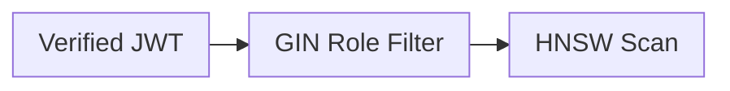

# Markdown Minimal Whitespace Skill
## Overview
Excessive vertical whitespace bloats Markdown documents and forces unnecessary scrolling. This skill enforces high-density, zero-waste vertical formatting across all `.md` files (achieving 30–35%+ line-count reduction) while preserving 100% of content, tables, links, diagrams, and CommonMark/GFM compatibility.
## When to use
- **Mandatory Default**: Applies automatically whenever writing, editing, generating, or refactoring **any** Markdown (`.md`) file (`README.md`, cheat sheets, notes, architecture docs, or skill files).
- Consolidating technical documentation or code snippets into a compact reference or cheat sheet.
- Explicit user requests to "reduce whitespace", "make it compact", "remove blank lines", or "fit on one page".
## Core concepts & Mandatory Rules
1. **Ultra-Compact Markdown Formatting**: Remove all standalone `---` or `***` dividers. Headings (`#`, `##`, `###`, `####`) provide sufficient separation with **0 blank lines** between headings and their adjacent paragraphs, lists, tables, and fenced code blocks. Consolidate multi-line TOCs into a single-line inline index (e.g. `**Navigation**: [1. Role](#1) | [2. Arch](#2)`).
2. **Eliminate Repetitive Subheadings (Table Consolidation)**: Never use separate `### Subheadings` for short one-liner key-value items or language/feature comparisons (e.g. `### Data Model`, `### Interface`, `### Cancellation`). Each heading injects heavy margin/padding in Markdown renderers. Instead, consolidate short comparisons into a compact GFM table (`| Concept | Source | Target |`) or tight inline bullet list (`- **Key**: Value`).
3. **Mermaid Diagram Compaction**: Add compact directives `%%{init: {'flowchart': {'nodeSpacing': 15, 'rankSpacing': 25, 'padding': 8}, 'sequence': {'messageMargin': 22}}}%%`, chain transitions inline (`A --> B --> C`), and strip all interior blank lines.
4. **Code, Config & Schema Block Compaction**: Strip vertical padding and interior blank lines across Python snippets, Go code, SQL DDL (`schema.sql`), YAML (`docker-compose.yml`), `Dockerfile`, `.env`, PowerShell/Bash scripts, directory trees, and ASCII diagrams. Inline single-statement guard clauses (`if not roles: return []`).
5. **Tight Lists, Tables & Single-Newline Ceiling**: Use tight lists (`*`, `-`, `1.`) with **0 blank lines** between items. Tables and code blocks sit directly beneath headings or list items without blank lines. Never allow consecutive blank lines.
6. **Mandatory Website Synchronization (`abyssium-studio`)**: Whenever `c:\src\enterprise-rag-pgvector-rbac\README.md` or `c:\src\abyssium-studio\README.md` is updated, synchronize [`src/components/MermaidBlueprints.tsx`](file:///c:/src/abyssium-studio/src/components/MermaidBlueprints.tsx) in `c:\src\abyssium-studio` and verify `npm run lint` and `npm run build` pass with zero errors.
## Practical workflow
1. **Strip Decorative Dividers & Collapse Navigation**: Remove standalone `---` lines (except YAML frontmatter at line 1) and inline TOCs.
2. **Convert Repetitive Subheadings to Tables/Tight Lists**: Scan for clusters of `### Subheadings` holding only 1–2 lines of content; convert them into a single comparison table (`| ... |`) or tight bullet list.
3. **Tighten Headings, Lists & Tables**: Remove all blank lines following `#`, `##`, `###`, `####`, between list items, and around tables and code fences.
4. **Compact Mermaid Blocks**: Add compact layout init, chain transitions inline, and delete interior blank lines.
5. **Compact Code & Config**: Strip interior blank lines from code snippets, SQL, YAML, Dockerfiles, env files, and shell commands.
6. **Sync Website & Verify Build**: If `README.md` in either repo was modified, sync `MermaidBlueprints.tsx` and run lint/build.
### Example
````markdown
## 1. Shift-Left Vector RBAC
**Quick Navigation:** [1. RBAC](#1-shift-left-vector-rbac) • [2. Architecture](#2-architecture)
| Component | Responsibility | Performance Target |
| :--- | :--- | :--- |
| **GIN Filter** | Pre-filter by user roles before ANN search | < 2ms |
| **HNSW Index** | Cosine similarity vector search | < 10ms (p95) |

```python
def shift_left_search(vec, chunks, roles):
    if not roles: return []
    return sorted((c for c in chunks if c.roles & roles), key=lambda c: sim(vec, c.vec))
```
````
## Common pitfalls
- **Creating Heading Clutter**: Avoid using `###` or `####` for key-value items or micro-comparisons; prefer tables or tight bold lists to avoid large renderer gaps.
- **Deleting YAML Frontmatter**: Do NOT remove the opening/closing `---` of frontmatter.
- **Forgetting Website Sync**: Always sync `MermaidBlueprints.tsx` and test builds after compacting repo READMEs.
- **Unclosed Code Fences**: Ensure every opening code fence has its matching closing fence on its own line.