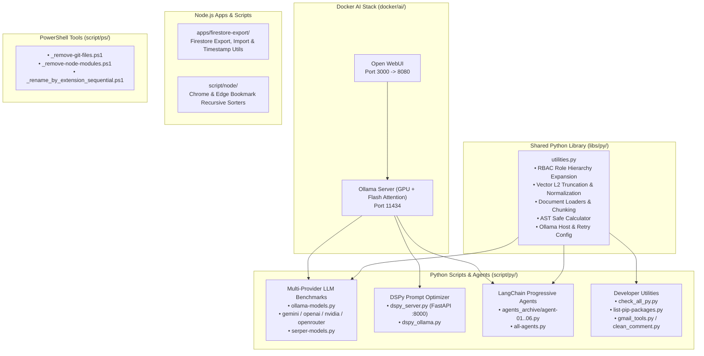

# PoC & Engineering Sandbox Workspace

A multi-language Proof of Concept (PoC), AI engineering, and systems architecture workspace combining **Python** (LLM benchmarking, DSPy prompt optimization, LangChain 1.x agents, distributed systems/IAM practice), **Node.js** (Firestore data migration, browser bookmark automation), **PowerShell** (workspace cleanup & batch media conversion), and **Docker** (GPU-accelerated local Ollama + Open WebUI stack).

---

## Architecture Overview



---

## Repository Structure

```text
poc/
├── agents/                         # Multi-agent framework sandboxes (crewAI, hermes)
├── apps/
│   └── firestore-export/           # ESM Node.js toolkit for exporting/importing Firestore collections
├── docker/
│   └── ai/
│       ├── docker-compose-ollama.yml # NVIDIA GPU-enabled Ollama service + model puller
│       └── docker-compose-webui.yml  # Open WebUI container connected to local Ollama
├── libs/
│   └── py/                         # Shared installable Python package (py-libraries / utilities.py)
├── practice/
│   └── py/                         # Python coding & systems architecture sandbox
└── script/
    ├── node/                       # Chrome & Edge bookmark alphabetical sorters
    ├── ps/                         # PowerShell cleanup & batch media conversion scripts
    └── py/                         # LLM provider benchmarks, DSPy server, and LangChain agents
        └── agents_archive/         # Progressive LangChain + Ollama agent implementations (01-06)
```

---

## Getting Started

### Prerequisites
- **Python**: 3.10+ (`uv` or `venv` recommended)
- **Node.js**: 18+
- **PowerShell**: 7+ (or Windows PowerShell 5.1+)
- **Docker Desktop**: With NVIDIA Container Toolkit (for GPU-accelerated local Ollama)

### Global Setup

1. **Configure Environment Variables**:
   Ensure `.env` in the repository root is populated with required provider keys:
   ```ini
   OPENAI_API_KEY=...
   GOOGLE_API_KEY=...
   NVIDIA_API_KEY=...
   OPENROUTER_API_KEY=...
   SERPER_API_KEY=...
   DATABASE_URL=postgresql://...
   OLLAMA_HOST=http://localhost:11434
   ```

2. **Install Shared Python Library (Editable Mode)**:
   ```powershell
   pip install -e libs/py
   ```

---

## Key Modules & Usage

### 1. Multi-Provider LLM & Search Benchmarks (`script/py/`)
Test model availability, latency, and error grouping concurrently across providers:
```powershell
# Run all cloud provider model tests (NVIDIA, Gemini, OpenAI, OpenRouter, Serper)
python script/py/run-all-model-tests.py

# Test local or remote Ollama models
python script/py/ollama-models.py --host http://localhost:11434
```

### 2. DSPy Cinematic Video Prompt Optimizer (`script/py/`)
Uses `dspy.ChainOfThought` with local `ollama/gemma4:e2b` to transform creative briefs into structured `Subject -> Style -> Camera -> Lighting` prompts:
```powershell
# CLI execution
python script/py/dspy_ollama.py

# FastAPI Server (POST /api/chat/optimize on http://127.0.0.1:8000)
python script/py/dspy_server.py
```

### 3. Progressive LangChain Agents (`script/py/agents_archive/`)
Demonstrates local agent patterns from basic chains to LangChain 1.x `create_agent` with AST-safe math evaluation (`safe_calculate`):
```powershell
# Run all 6 agent examples sequentially
python script/py/agents_archive/all-agents.py
```

### 4. Syntax Validation & Package Auditing (`script/py/`)
```powershell
# Concurrently syntax-check all Python files in the repository
python script/py/check_all_py.py

# List pip packages not modified/accessed in the last 30 days
python script/py/list-pip-packages.py
```

### 5. Node.js Utilities (`apps/firestore-export/` & `script/node/`)
```powershell
# Sort Chrome or Edge bookmarks (automatically creates a .backup file first)
cd script/node
npm run sort:chrome
npm run sort:edge
```

### 6. Docker Local AI Stack (`docker/ai/`)
```powershell
docker compose -f docker/ai/docker-compose-ollama.yml up -d
docker compose -f docker/ai/docker-compose-webui.yml up -d
```

### 7. PowerShell Maintenance (`script/ps/`)
```powershell
# Preview recursive node_modules removal with -WhatIf
.\script\ps\_remove-node-modules.ps1 -Path "C:\target\path" -WhatIf

# Preview recursive .git artifact cleanup with -WhatIf
.\script\ps\_remove-git-files.ps1 -Path "C:\target\path" -WhatIf
```
