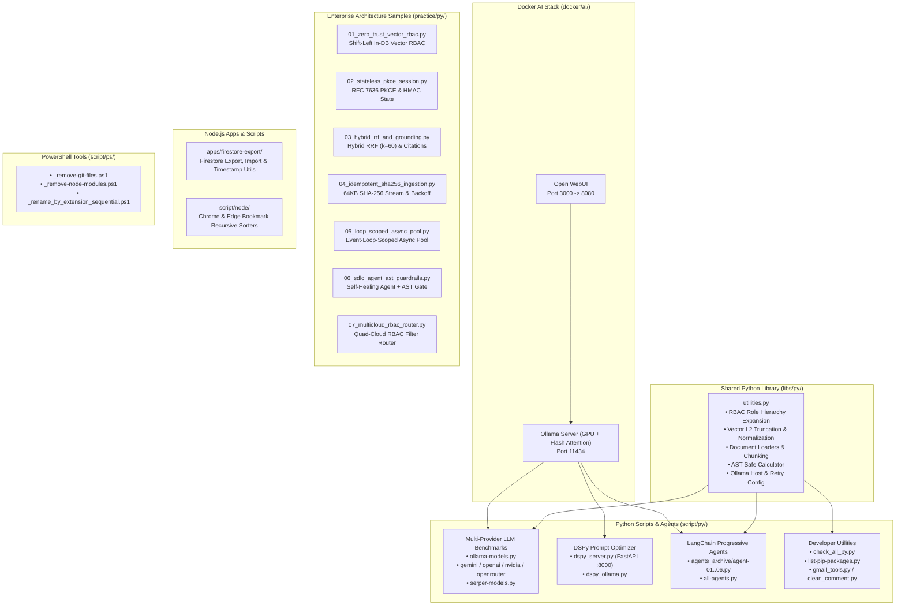

# PoC & Engineering Sandbox Workspace

A multi-language Proof of Concept (PoC), AI engineering, and systems architecture workspace combining **Python** (Enterprise Zero-Trust RAG interview pattern samples, LLM benchmarking, DSPy prompt optimization, LangChain 1.x agents), **Node.js** (Firestore data migration, browser bookmark automation), **PowerShell** (workspace cleanup & batch media conversion), and **Docker** (GPU-accelerated local Ollama + Open WebUI stack).

---

## Architecture Overview



---

## Repository Structure

```text
poc/
├── agents/                         # Multi-agent framework sandboxes (crewAI, hermes)
├── apps/
│   └── firestore-export/           # ESM Node.js toolkit for exporting/importing Firestore collections
├── docker/
│   └── ai/
│       ├── docker-compose-ollama.yml # NVIDIA GPU-enabled Ollama service + model puller
│       └── docker-compose-webui.yml  # Open WebUI container connected to local Ollama
├── libs/
│   └── py/                         # Shared installable Python package (py-libraries / utilities.py)
├── practice/
│   └── py/                         # 7 Lean Enterprise AI & Systems Architecture Reference Samples
│       ├── 01_zero_trust_vector_rbac.py      # Shift-Left In-DB RBAC vs. Post-Filter Recall Starvation
│       ├── 02_stateless_pkce_session.py      # RFC 7636 OAuth 2.0 PKCE (S256) & Stateless HMAC State
│       ├── 03_hybrid_rrf_and_grounding.py    # Reciprocal Rank Fusion (RRF k=60) & Citation Guardrails
│       ├── 04_idempotent_sha256_ingestion.py # 64KB Streaming SHA-256 De-duplication & Retry Backoff
│       ├── 05_loop_scoped_async_pool.py      # Event-Loop-Scoped Async Client/Pool Lifecycle Manager
│       ├── 06_sdlc_agent_ast_guardrails.py   # Self-Healing SDLC Loop + Pre-Execution AST Security Gate
│       └── 07_multicloud_rbac_router.py      # Quad-Mode Multi-Cloud RBAC Filter Compiler (PG/Azure/GCP/DBX)
└── script/
    ├── node/                       # Chrome & Edge bookmark alphabetical sorters
    ├── ps/                         # PowerShell cleanup & batch media conversion scripts
    └── py/                         # LLM provider benchmarks, DSPy server, and LangChain agents
        └── agents_archive/         # Progressive LangChain + Ollama agent implementations (01-06)
```

---

## Enterprise AI & Systems Architecture Patterns (`practice/py/`)

Each script in [`practice/py/`](practice/py/) is a **lean (~50–75 lines), zero-dependency, self-contained Python reference implementation** distilled from [`enterprise-rag-pgvector-rbac`](https://github.com/Kenono2000/enterprise-rag-pgvector-rbac) for technical interviews and live architecture demonstrations:

| # | Script | Pattern & Core Architectural Invariant | Key Functions / Classes |
| :-: | :--- | :--- | :--- |
| **01** | [`01_zero_trust_vector_rbac.py`](practice/py/01_zero_trust_vector_rbac.py) | **Shift-Left In-Database Vector RBAC**: Demonstrates why post-filtering causes *Recall Starvation* vs. pre-filtering (`WHERE d.allowed_roles ?\| $2::text[]`), role allowlist sanitization (`KNOWN_ROLES`), and empty-role short-circuiting. | `shift_left_rbac_search`, `post_filter_search`, `sanitize_roles` |
| **02** | [`02_stateless_pkce_session.py`](practice/py/02_stateless_pkce_session.py) | **Stateless OAuth 2.0 PKCE & HMAC State**: RFC 7636 `S256` challenge derivation + embedding the verifier and TTL into an HMAC-SHA256 signed state token (`hmac.compare_digest`) with zero server-side Redis/memory storage. | `generate_pkce_pair`, `encode_stateless_state`, `decode_stateless_state` |
| **03** | [`03_hybrid_rrf_and_grounding.py`](practice/py/03_hybrid_rrf_and_grounding.py) | **Hybrid Search (RRF $k=60$) & Grounding Guardrail**: Merges dense (semantic) and sparse (lexical SKU/error code) rankings via Reciprocal Rank Fusion and regex-verifies `[Doc: <ID>, Chunk <N>]` citations against authorized context. | `reciprocal_rank_fusion`, `validate_grounding` |
| **04** | [`04_idempotent_sha256_ingestion.py`](practice/py/04_idempotent_sha256_ingestion.py) | **Idempotent SHA-256 Ingestion & Backoff**: $O(1)$ memory 64KB chunked SHA-256 hashing (`while chunk := stream.read(65536)`), change detection (skip unchanged / purge & re-index modified), batch slicing, and exponential backoff. | `compute_stream_sha256`, `IdempotentIngestor`, `call_with_backoff`, `batch_slice` |
| **05** | [`05_loop_scoped_async_pool.py`](practice/py/05_loop_scoped_async_pool.py) | **Event-Loop-Scoped Async Client/Pool Manager**: Solves `RuntimeError: Event loop is closed` in multi-threaded workers (Streamlit/FastAPI) by keying clients by `asyncio.get_running_loop()` and pruning closed loops. | `LoopScopedManager`, `get_client` |
| **06** | [`06_sdlc_agent_ast_guardrails.py`](practice/py/06_sdlc_agent_ast_guardrails.py) | **Self-Healing SDLC Agent + AST Security Gate**: Static `ast.walk()` inspection blocking `eval`/`exec`/`__import__`, regex secret scanning, path traversal prevention (`is_relative_to`), and a 3-attempt test-repair loop. | `audit_patch`, `is_safe_path`, `run_self_healing_cycle` |
| **07** | [`07_multicloud_rbac_router.py`](practice/py/07_multicloud_rbac_router.py) | **Quad-Mode Multi-Cloud Zero-Trust RBAC Router**: Compiles verified roles into native pre-filters across PostgreSQL (`pgvector`), Azure AI Search (OData `allowed_roles/any`), GCP Vertex AI (`allowList` restricts), and Databricks (`filters_json`). | `build_rbac_filter` |

```powershell
# Run any of the 7 standalone architecture samples directly:
python practice/py/01_zero_trust_vector_rbac.py
python practice/py/02_stateless_pkce_session.py
python practice/py/03_hybrid_rrf_and_grounding.py
python practice/py/04_idempotent_sha256_ingestion.py
python practice/py/05_loop_scoped_async_pool.py
python practice/py/06_sdlc_agent_ast_guardrails.py
python practice/py/07_multicloud_rbac_router.py
```

---

## Getting Started

### Prerequisites
- **Python**: 3.10+ (`uv` or `venv` recommended)
- **Node.js**: 18+
- **PowerShell**: 7+ (or Windows PowerShell 5.1+)
- **Docker Desktop**: With NVIDIA Container Toolkit (for GPU-accelerated local Ollama)

### Global Setup

1. **Configure Environment Variables**:
   Ensure `.env` in the repository root is populated with required provider keys:
   ```ini
   OPENAI_API_KEY=...
   GOOGLE_API_KEY=...
   NVIDIA_API_KEY=...
   OPENROUTER_API_KEY=...
   SERPER_API_KEY=...
   DATABASE_URL=postgresql://...
   OLLAMA_HOST=http://localhost:11434
   ```

2. **Install Shared Python Library (Editable Mode)**:
   ```powershell
   pip install -e libs/py
   ```

---

## Other Modules & Usage

### 1. Multi-Provider LLM & Search Benchmarks (`script/py/`)
Test model availability, latency, and error grouping concurrently across providers:
```powershell
# Run all cloud provider model tests (NVIDIA, Gemini, OpenAI, OpenRouter, Serper)
python script/py/run-all-model-tests.py

# Test local or remote Ollama models
python script/py/ollama-models.py --host http://localhost:11434
```

### 2. DSPy Cinematic Video Prompt Optimizer (`script/py/`)
Uses `dspy.ChainOfThought` with local `ollama/gemma4:e2b` to transform creative briefs into structured `Subject -> Style -> Camera -> Lighting` prompts:
```powershell
# CLI execution
python script/py/dspy_ollama.py

# FastAPI Server (POST /api/chat/optimize on http://127.0.0.1:8000)
python script/py/dspy_server.py
```

### 3. Progressive LangChain Agents (`script/py/agents_archive/`)
Demonstrates local agent patterns from basic chains to LangChain 1.x `create_agent` with AST-safe math evaluation (`safe_calculate`):
```powershell
# Run all 6 agent examples sequentially
python script/py/agents_archive/all-agents.py
```

### 4. Syntax Validation & Package Auditing (`script/py/`)
```powershell
# Concurrently syntax-check all Python files in the repository
python script/py/check_all_py.py

# List pip packages not modified/accessed in the last 30 days
python script/py/list-pip-packages.py
```

### 5. Node.js Utilities (`apps/firestore-export/` & `script/node/`)
```powershell
# Sort Chrome or Edge bookmarks (automatically creates a .backup file first)
cd script/node
npm run sort:chrome
npm run sort:edge
```

### 6. Docker Local AI Stack (`docker/ai/`)
```powershell
docker compose -f docker/ai/docker-compose-ollama.yml up -d
docker compose -f docker/ai/docker-compose-webui.yml up -d
```

### 7. PowerShell Maintenance (`script/ps/`)
```powershell
# Preview recursive node_modules removal with -WhatIf
.\script\ps\_remove-node-modules.ps1 -Path "C:\target\path" -WhatIf

# Preview recursive .git artifact cleanup with -WhatIf
.\script\ps\_remove-git-files.ps1 -Path "C:\target\path" -WhatIf
```
