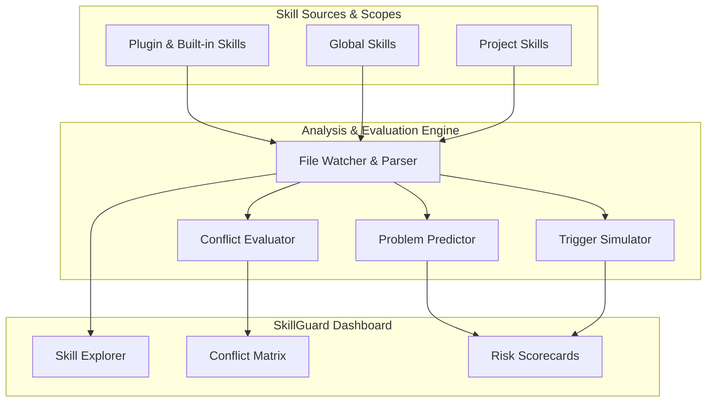

# SkillGuard
Lightweight CLI and embedded web dashboard to manage global and project-specific agent skills, evaluate skill conflicts, and predict skill problems.
## Features
- **Skill Discovery**: Scans global (`~/.gemini/config/skills`, `~/.agents/skills`) and project (`.agent/skills`, `.gemini/skills`) `SKILL.md` files.
- **Conflict Evaluation**: Detects `name_collision`, `trigger_overlap`, and `rule_contradiction` across scopes.
- **Problem Prediction**: Flags `token_bloat`, `trigger_ambiguity`, `missing_guardrail`, and `brittle_path` issues.
- **Embedded Web Dashboard**: Local dark-mode UI served via FastAPI at `http://127.0.0.1:8765`.
## Installation
```powershell
# Local editable install (with dev tools)
python -m pip install -e ".[dev]"
# Or install on another machine via pipx
pipx install git+https://github.com/Kenono2000/poc.git
```
## Usage
```powershell
# List discovered skills
skillguard scan --project d:\src\poc
# Evaluate conflicts and predict problems
skillguard check --project d:\src\poc
# Launch the embedded web dashboard
skillguard ui --project d:\src\poc --port 8765
```
## Development
```powershell
python -m pytest -q
python -m ruff check --select E,W,F,I,B,S src tests
```
## Application Design
### System Architecture

### Core Data Model
- **`SkillNode`**: `id`, `name`, `scope` (`global` | `project` | `plugin` | `builtin`), `path`, `priority`, `frontmatter` (`description`, `triggers`, `dependencies`), `metrics` (`tokenCount`, `imperativeCount`, `lastModified`).
- **`ConflictReport`**: `severity` (`critical` | `warning` | `info`), `type` (`name_collision` | `trigger_overlap` | `rule_contradiction` | `missing_dependency`), `involvedSkills`, `explanation`, `suggestedResolution`.
- **`PredictionReport`**: `riskScore` (0–100), `predictedIssues` (`token_bloat`, `false_positive_trigger`, `false_negative_trigger`, `instruction_drift`, `stale_reference`).
### Conflict Evaluation Engine
- **Namespace & Override Resolution**: Maps effective skill resolution order (`Project > Global > Plugin > Built-in`) and flags unintended shadowing.
- **Semantic Trigger Overlap**: Embeds each skill's `description` and trigger phrases, flagging pairs with high similarity that lack mutually exclusive `"Don't use for..."` guardrails.
- **Instruction Contradiction Detection**: Extracts normative statements (`ALWAYS`, `NEVER`, `MUST`, `DO NOT`) from `SKILL.md` bodies to detect opposing directives.
- **Dependency & Environment Validation**: Cross-checks referenced MCP tools, CLI binaries, and subagent names against active workspace/environment config.
### Predictive Problem Engine
- **Context Budget & Token Bloat**: Calculates total token footprint of always-on descriptions + loaded `SKILL.md` bodies to warn before context crowding.
- **Synthetic Prompt Simulation**: Tests ambiguous, multi-intent, or negative prompts against the skill router to predict over-triggering and under-triggering.
- **Drift & Brittleness Scoring**: Flags hardcoded file paths, unpinned external URLs, or missing fallback instructions.
### Architecture Options Comparison
| Dimension | Option A: FastAPI Backend + Next.js Frontend | Option B: Lightweight CLI + Embedded Web Dashboard (MVP) |
| :--- | :--- | :--- |
| **Setup & Footprint** | Heavier: Python venv + Node.js/npm, two dev servers (or Docker). | Very light: single installable package (`pipx`), one command (`skillguard ui`). |
| **CI/CD & Automation** | Needs extra API/script wrappers for GitHub Actions or pre-commit hooks. | **Native fit**: `skillguard check` runs directly in terminal, pre-commit, and CI. |
| **AI / ML & Embeddings** | **Strongest**: Python ecosystem (`sentence-transformers`, `litellm`, `pydantic`). | Good with Python-based CLI + local FastAPI. |
| **UI Richness & UX** | **Best**: Full React/Next.js ecosystem for interactive matrices and diff editors. | Simpler: good for read-only dashboards and basic forms. |
| **Maintenance** | Two codebases, CORS/API schema syncing, build pipelines. | Single repo/package, minimal surface area, faster to iterate. |
| **Best For** | Multi-user or team-hosted platform with deep interactive editing. | Local-first developer tool used alongside coding agents and CI gates. |
## Improving Skills with SkillGuard
1. **Run an audit** via `skillguard check --project .` (or `skillguard ui --project .` for the dashboard).
2. **Resolve findings**:
   - **`name_collision` (`critical`)**: Rename or remove duplicate skills so project skills don't silently shadow global ones.
   - **`trigger_overlap` (`warning`) & `missing_guardrail` (`info`)**: Add `"Don't use for..."` boundaries to YAML `description` fields to prevent false-positive activation.
   - **`rule_contradiction` (`warning`)**: Align conflicting `ALWAYS` / `NEVER` directives between overlapping skills.
   - **`token_bloat` (`critical`)**: Move large examples or reference tables into a `references/` subfolder.
   - **`brittle_path` (`warning`)**: Replace hardcoded machine paths with relative paths or environment variables.
3. **Automate in CI / pre-commit**: Run `skillguard check --project .` on every commit to prevent regressions.


