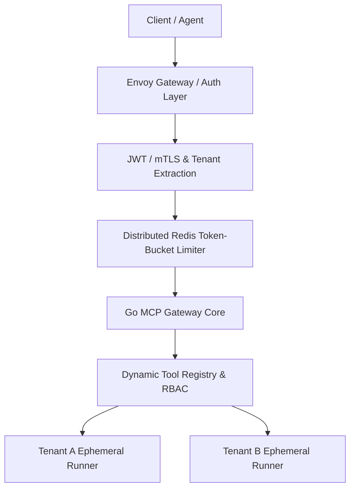
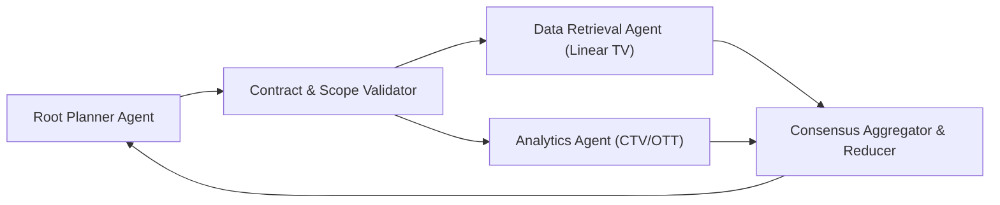
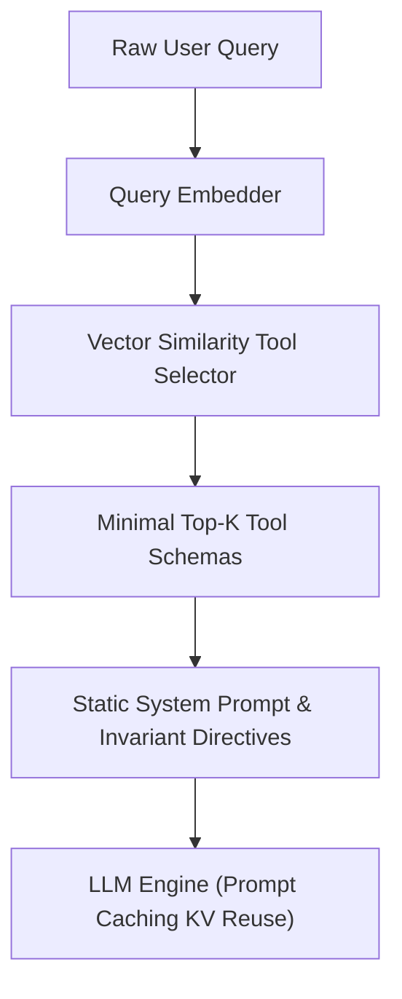
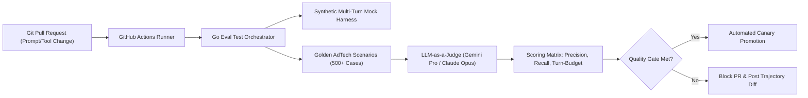

# VideoAmp Principal AI Infrastructure Engineer: Comprehensive Interview & Coding Guide
**Navigation**: [1. Role & Profile](#1-role--strategic-profile) | [2. Polyglot Transition Guide](#2-polyglot-transition-guide-c-typescript--python-to-go) | [3. Interview Process & ATOLA](#3-videoamp-interview-process--assessment-methodology) | [4. Production Go Patterns](#4-production-go-coding-patterns-for-the-assessment) | [5. Architectural System Designs](#5-architectural-deep-dives--system-design-scenarios) | [6. Live Coding Traps](#6-live-coding-traps--how-to-avoid-them) | [7. Executive Communication & Questions](#7-executive-communication--strategic-questions)

## 1. Role & Strategic Profile
- **Company & Compensation**: VideoAmp (Remote, US) | $184,000 – $210,000 Base + Equity + Comprehensive Benefits.
- **Core Business**: Cross-platform audience measurement, deduplication, and currency planning across Linear TV, Connected TV (CTV), OTT, and digital video, transacting on verifiable business outcomes rather than legacy gross rating points.
- **AI Infrastructure Mandate**: Owns the high-throughput, low-latency Go runtime powering VideoAmp's agentic platform, bridging internal data APIs/warehouses (Snowflake, BigQuery) with agentic execution engines.
- **Core Values**: *One VideoAmp* (shared outcomes), *Own the Outcome* (end-to-end accountability), *Raise the Bar* (operational excellence).
- **Key Mandates**:
  1. *Multi-Tenant Tool Isolation*: MCP (Model Context Protocol) tool gateways with per-tenant quota enforcement and cryptographic caller attribution.
  2. *Durable Execution Runtimes*: Resilient agent loops with checkpointing, deterministic replay, and crash recovery.
  3. *A2A Protocols*: Structured delegation contracts, call-depth ceilings, and schema compatibility checks across agents.
  4. *Progressive Discovery & Prompt Caching*: Deferred tool schema hydration and prefix-cache optimization to minimize TTFT and KV-cache costs.
  5. *Evaluation-Driven Development (EDD)*: Golden scenario regression gates, automated synthetic LLM-as-a-judge pipelines in CI/CD.

## 2. Polyglot Transition Guide: C#, TypeScript & Python to Go
### The Rosetta Stone
| Concept | C# (.NET Core) | TypeScript / Node.js | Python (AsyncIO / Pydantic) | Go (Golang) |
|:---|:---|:---|:---|:---|
| **Data Contract** | `public class ToolReq { ... }` | `interface ToolReq { ... }` | `class ToolReq(BaseModel):` | `type ToolReq struct { ... }` |
| **Interfaces** | Explicit: `class Foo : IFoo` | Structural: `implements IFoo` | Duck typing / `Protocol` | **Implicit**: Satisfied by implementing method signatures |
| **Cancellation** | `CancellationToken ct` | `AbortController.signal` | `asyncio.wait_for()`, `Timeout` | **`ctx context.Context`** |
| **Async Exec** | `await Task.Run(...)` | `await Promise.all(...)` | `await asyncio.gather(...)` | **`go worker()` + WaitGroup / channels** |
| **Queueing** | `Channel<T>`, `BlockingCollection`| Worker threads / event loop | `asyncio.Queue` | **`chan T` (buffered / unbuffered)** |
| **Locking** | `lock (_lock) { ... }` | Mutex libraries / single-thread | `async with asyncio.Lock():` | `mu.Lock(); defer mu.Unlock()` |
| **Errors** | `try / catch (Exception ex)` | `try / catch (err)` | `try / except Exception as e:` | **`if err != nil { return err }` (values, not exceptions)** |
| **Null Safety** | `null`, `Nullable<T>` | `null / undefined` | `None / Optional[T]` | `nil` (pointers, slices, maps, channels, interfaces) |

### The 5 Non-Negotiable Go Idioms
#### 1. Structs, Tags & Instantiation
```go
type ToolRequest struct {
    TenantID string `json:"tenant_id"`
    MaxTurns int    `json:"max_turns"`
}
req := ToolRequest{TenantID: "tenant-a", MaxTurns: 5} // Stack allocation
reqPtr := &ToolRequest{TenantID: "tenant-a", MaxTurns: 5} // Heap pointer
```
#### 2. Methods on Structs (Pointer vs. Value Receivers)
```go
func (t *ToolRequest) IsValid() bool {
    if t == nil { return false }
    return t.MaxTurns > 0
}
```
*Rule*: Always use pointer receivers (`*T`) for infrastructure services containing locks, buffers, or state mutators to avoid mutex copies.
#### 3. Error Handling & Wrapping
```go
func DispatchTool(ctx context.Context, name string) (string, error) {
    if name == "" { return "", fmt.Errorf("tool name cannot be blank") }
    return "result", nil
}
res, err := DispatchTool(ctx, "aggregate_linear_tv")
if err != nil { return fmt.Errorf("dispatch stage failed: %w", err) }
```
#### 4. Slices, Maps & Allocation
```go
tools := make([]string, 0, 10) // Pre-allocate capacity to eliminate GC reallocations
quotas := make(map[string]int)
quotas["tenant-1"] = 100
if val, exists := quotas["tenant-1"]; exists { /* safe consumption */ }
```
#### 5. Concurrency: Goroutines, WaitGroups, Channels
```go
var wg sync.WaitGroup
for _, task := range tasks {
    wg.Add(1)
    go func(t Task) {
        defer wg.Done()
        process(t)
    }(task) // Explicit variable capture avoids closure aliasing
}
wg.Wait()
```

## 3. VideoAmp Interview Process & Assessment Methodology
### The Interview Loops
1. **Technical Recruiter Screen (30m)**: Role alignment, architectural philosophy, remote autonomy, and compensation matching.
2. **System Architecture & Platform Design (60m)**: Whiteboard session focusing on distributed event streaming, multi-tenant isolation, agentic runtime durability, and high-throughput AdTech deduplication.
3. **Live Go Coding & Concurrency Practical (60m)**: Production-grade implementation in Go (live IDE / CoderPad). Focus is on clean synchronization, context propagation, error hygiene, zero goroutine leaks, and bounded memory footprints.
4. **Cultural Alignment & Executive Debrief (45m)**: Evaluation of *One VideoAmp*, cross-functional enablement, post-mortem blamelessness, and architectural ownership.

### The ATOLA Communication Framework
When presented with complex live coding or architectural prompts, structure responses through **ATOLA**:
- **A — Ask (Clarify Constraints)**: Extract SLA/SLOs, expected RPS, tenant concurrency distributions, network partition guarantees, and idempotency boundaries before writing a single line.
- **T — Think (State Trade-offs Out Loud)**: Contrast architectural paths (e.g. Channel-based pipelines vs. Mutex-protected maps; In-memory rate limiting vs. Distributed Redis token-buckets).
- **O — Outline (Define Structs & Interfaces)**: Stub all data models, domain structs, and interface signatures. Show clear domain boundaries before filling in business logic.
- **L — Leverage (Idiomatic Implementation)**: Write idiomatic, readable, zero-leak Go code using `sync.WaitGroup`, buffered channels, atomic primitives, and `context.WithTimeout`.
- **A — Audit & Assert (Verify Edge Cases)**: Walk through shutdown cascades, race conditions (`go test -race`), context cancellations, poison pills, and nil-pointer edge conditions.

## 4. Production Go Coding Patterns for the Assessment
### Pattern 1: Multi-Tenant Token-Bucket Rate Limiter
```go
package main
import (
    "context"
    "sync"
    "time"
)
type TenantRateLimiter struct {
    mu          sync.RWMutex
    buckets     map[string]*tokenBucket
    rate        float64
    capacity    float64
    idleTimeout time.Duration
}
type tokenBucket struct {
    mu         sync.Mutex
    tokens     float64
    lastRefill time.Time
    lastAccess time.Time
}
func NewTenantRateLimiter(rate, capacity float64, idleTimeout time.Duration) *TenantRateLimiter {
    return &TenantRateLimiter{buckets: make(map[string]*tokenBucket), rate: rate, capacity: capacity, idleTimeout: idleTimeout}
}
func (l *TenantRateLimiter) Allow(tenantID string, cost float64) bool {
    l.mu.RLock()
    tb, exists := l.buckets[tenantID]
    l.mu.RUnlock()
    if !exists {
        l.mu.Lock()
        if tb, exists = l.buckets[tenantID]; !exists {
            tb = &tokenBucket{tokens: l.capacity, lastRefill: time.Now(), lastAccess: time.Now()}
            l.buckets[tenantID] = tb
        }
        l.mu.Unlock()
    }
    return tb.take(cost, l.rate, l.capacity)
}
func (tb *tokenBucket) take(cost, rate, capacity float64) bool {
    tb.mu.Lock()
    defer tb.mu.Unlock()
    now := time.Now()
    elapsed := now.Sub(tb.lastRefill).Seconds()
    tb.lastRefill = now
    tb.tokens += elapsed * rate
    if tb.tokens > capacity { tb.tokens = capacity }
    tb.lastAccess = now
    if tb.tokens >= cost {
        tb.tokens -= cost
        return true
    }
    return false
}
func (l *TenantRateLimiter) StartJanitor(ctx context.Context, sweepInterval time.Duration) {
    go func() {
        ticker := time.NewTicker(sweepInterval)
        defer ticker.Stop()
        for {
            select {
            case <-ctx.Done(): return
            case <-ticker.C:
                l.mu.Lock()
                now := time.Now()
                for id, tb := range l.buckets {
                    tb.mu.Lock()
                    idle := now.Sub(tb.lastAccess)
                    tb.mu.Unlock()
                    if idle > l.idleTimeout { delete(l.buckets, id) }
                }
                l.mu.Unlock()
            }
        }
    }()
}
```

### Pattern 2: Resilient Agent Tool Orchestration Loop
```go
package main
import (
    "context"
    "errors"
    "fmt"
    "sync"
    "time"
)
type ToolCall struct {
    ID        string
    Name      string
    Arguments map[string]any
}
type AgentMessage struct {
    Role       string
    Content    string
    ToolCalls  []ToolCall
    ToolCallID string
}
type ToolRegistry interface {
    Execute(ctx context.Context, name string, args map[string]any) (string, error)
}
type LLMClient interface {
    Complete(ctx context.Context, messages []AgentMessage) (AgentMessage, error)
}
type AgentEngine struct {
    llm      LLMClient
    tools    ToolRegistry
    maxTurns int
}
func NewAgentEngine(llm LLMClient, tools ToolRegistry, maxTurns int) *AgentEngine {
    return &AgentEngine{llm: llm, tools: tools, maxTurns: maxTurns}
}
func (e *AgentEngine) Run(ctx context.Context, prompt string) (string, error) {
    history := []AgentMessage{{Role: "user", Content: prompt}}
    for turn := 0; turn < e.maxTurns; turn++ {
        select {
        case <-ctx.Done(): return "", fmt.Errorf("agent run cancelled: %w", ctx.Err())
        default:
        }
        resp, err := e.llm.Complete(ctx, history)
        if err != nil { return "", fmt.Errorf("llm failed at turn %d: %w", turn, err) }
        history = append(history, resp)
        if len(resp.ToolCalls) == 0 { return resp.Content, nil }
        toolResults := e.dispatchToolsConcurrently(ctx, resp.ToolCalls)
        history = append(history, toolResults...)
    }
    return "", errors.New("agent turn ceiling exceeded without reaching completion")
}
func (e *AgentEngine) dispatchToolsConcurrently(ctx context.Context, calls []ToolCall) []AgentMessage {
    results := make([]AgentMessage, len(calls))
    var wg sync.WaitGroup
    for i, tc := range calls {
        wg.Add(1)
        go func(idx int, call ToolCall) {
            defer wg.Done()
            tCtx, cancel := context.WithTimeout(ctx, 15*time.Second)
            defer cancel()
            output, err := e.tools.Execute(tCtx, call.Name, call.Arguments)
            if err != nil { output = fmt.Sprintf("Tool %s error: %v", call.Name, err) }
            results[idx] = AgentMessage{Role: "tool", Content: output, ToolCallID: call.ID}
        }(i, tc)
    }
    wg.Wait()
    return results
}
```

### Pattern 3: Bounded Worker Pool with Graceful Drain
```go
package main
import (
    "context"
    "errors"
    "fmt"
    "sync"
    "time"
)
type AgentTask struct {
    ID       string
    TenantID string
    Execute  func(ctx context.Context) error
}
type WorkerPool struct {
    workers    int
    taskQueue  chan AgentTask
    wg         sync.WaitGroup
    shutdownMu sync.Mutex
    isClosed   bool
}
func NewWorkerPool(workers int, queueCapacity int) *WorkerPool {
    wp := &WorkerPool{workers: workers, taskQueue: make(chan AgentTask, queueCapacity)}
    wp.start()
    return wp
}
func (wp *WorkerPool) start() {
    for i := 0; i < wp.workers; i++ {
        wp.wg.Add(1)
        go func(id int) {
            defer wp.wg.Done()
            for task := range wp.taskQueue {
                tCtx, cancel := context.WithTimeout(context.Background(), 30*time.Second)
                if err := task.Execute(tCtx); err != nil {
                    fmt.Printf("[Err] Worker=%d Task=%s: %v\n", id, task.ID, err)
                }
                cancel()
            }
        }(i)
    }
}
func (wp *WorkerPool) Submit(t AgentTask) error {
    wp.shutdownMu.Lock()
    defer wp.shutdownMu.Unlock()
    if wp.isClosed { return errors.New("worker pool stopped: rejecting task") }
    select {
    case wp.taskQueue <- t: return nil
    default: return errors.New("worker queue saturated: backpressure triggered")
    }
}
func (wp *WorkerPool) Shutdown(timeout time.Duration) error {
    wp.shutdownMu.Lock()
    if wp.isClosed { wp.shutdownMu.Unlock(); return nil }
    wp.isClosed = true
    close(wp.taskQueue)
    wp.shutdownMu.Unlock()
    done := make(chan struct{})
    go func() { wp.wg.Wait(); close(done) }()
    select {
    case <-done: return nil
    case <-time.After(timeout): return errors.New("pool shutdown timed out: forced exit")
    }
}
```

### Pattern 4: Sliding-Window Impression Deduplicator
```go
package main
import (
    "context"
    "fmt"
    "sync"
    "time"
)
type ImpressionEvent struct {
    DeviceID   string
    CampaignID string
    Timestamp  time.Time
}
type Deduplicator struct {
    mu           sync.RWMutex
    window       time.Duration
    seen         map[string]time.Time
    campaignHits map[string]int64
}
func NewDeduplicator(window time.Duration) *Deduplicator {
    return &Deduplicator{window: window, seen: make(map[string]time.Time), campaignHits: make(map[string]int64)}
}
func (d *Deduplicator) Ingest(e ImpressionEvent) bool {
    key := fmt.Sprintf("%s:%s", e.DeviceID, e.CampaignID)
    d.mu.Lock()
    defer d.mu.Unlock()
    if last, found := d.seen[key]; found && e.Timestamp.Sub(last) < d.window {
        return false
    }
    d.seen[key] = e.Timestamp
    d.campaignHits[e.CampaignID]++
    return true
}
func (d *Deduplicator) StartCleanup(ctx context.Context, interval time.Duration) {
    go func() {
        ticker := time.NewTicker(interval)
        defer ticker.Stop()
        for {
            select {
            case <-ctx.Done(): return
            case <-ticker.C:
                d.mu.Lock()
                now := time.Now()
                for k, ts := range d.seen {
                    if now.Sub(ts) > d.window { delete(d.seen, k) }
                }
                d.mu.Unlock()
            }
        }
    }()
}
```

## 5. Architectural Deep Dives & System Design Scenarios
### Architectural Scenario 1: Multi-Tenant MCP Tool Gateway

- **Context & SLA**: Provide sub-20ms proxy latency for MCP tool calls across thousands of enterprise tenants.
- **Tenant Isolation**: mTLS + signed JWT claims containing `tenant_id`, `org_tier`, and authorized tool scopes. Requests map directly to sandboxed tool runners or localized execution pods.
- **Cryptographic Attribution**: Every tool call is hashed and signed with an internal HMAC token recorded in audit trails for enterprise compliance.
- **Fail-Safe Circuit Breaking**: Outgoing tool requests leverage per-domain exponential backoff circuit breakers (`hystrix-go` or custom atomic state machines) to prevent slow upstream platforms (e.g. ad networks) from exhausting gateway goroutines.

### Architectural Scenario 2: Agent-to-Agent (A2A) Delegation Protocols

- **Call-Depth Ceilings**: Strict hop-count headers (`X-Agent-Depth: 3`, `X-Execution-Trace-ID`) propagated in Go context to guarantee protection against infinite recursion loops.
- **Distributed Context Propagation**: Use OpenTelemetry W3C trace context format (`traceparent`) carried over gRPC / HTTP2 metadata across agents.
- **Deterministic Replay & Checkpointing**: Agent state mutations are event-sourced to an append-only WAL (PostgreSQL or Kafka), allowing failed sub-agents to restart from their latest confirmed turn without re-running completed tool actions.

### Architectural Scenario 3: Progressive Context Discovery & Prefix Caching

- **The Problem**: Dumping 200+ MCP tool schemas into an agent's system prompt consumes 30k+ tokens, increases Time-To-First-Token (TTFT), introduces model confusion, and wastes KV-cache resources.
- **Progressive Discovery Engine**:
  1. *L1 Category Registry*: Agent only sees high-level categories (e.g., `AudienceQuery`, `CampaignPlanning`, `Reporting`).
  2. *L2 Dynamic Hydration*: When an agent chooses a domain, tools within that domain are loaded just-in-time into context.
- **Prefix Caching Alignment**: Ensure the first `N` tokens (static system instructions, invariant capability lists) are byte-for-byte identical across turns to maximize Claude/Gemini KV-cache hit rates (>80%), driving down inference cost and latency.

### Architectural Scenario 4: CI/CD Automated Evaluation Framework (EDD)

- **Golden Scenario Matrix**: Version-controlled YAML scenario files specifying initial prompts, expected tool-call trajectories, permitted argument tolerances, and acceptable final answers.
- **Deterministic Mocking**: Intercept network calls via an internal replay HTTP client so regression tests run reliably without incurring production API billing or non-deterministic variance.
- **Trajectory Diffs**: If a PR causes an agent to take 6 turns instead of 2 to resolve a Linear TV campaign question, flag it as a trajectory regression directly in the PR review comments.

## 6. Live Coding Traps & How to Avoid Them
| Potential Trap | What Happens in Go | The Fix / Senior Idiom |
|:---|:---|:---|
| **Goroutine Loop Variable Capture** | All goroutines share the final iteration value. | Pass variable explicitly into goroutine: `go func(item T) { ... }(item)` |
| **Goroutine Leaks** | Worker goroutines block indefinitely on unbuffered channels when receiver stops. | Use `ctx.Done()` or buffered channels matching batch size. |
| **Copying Mutex by Value** | Struct copies copy the lock state, causing independent locks and race conditions. | Pass structs containing mutexes as pointers (`*Service`), never by value. |
| **`defer` in a Tight Loop** | `defer` runs when enclosing *function* exits, exhausting file descriptors/memory. | Wrap loop body in an inline function or separate helper: `func() { ... }()` |
| **Unbounded Map Growth** | Long-running cache/rate-limiter maps eventually cause out-of-memory (OOM) crashes. | Implement a background janitor goroutine with ticker-based sweep. |
| **Direct JSON Map Marshaling** | Weak typing leads to panics on type assertions (`item.(string)`). | Parse into strongly-typed Go structs with explicit `json:"field"` tags. |
| **Premature Channel Closing** | Calling `close()` on a channel while concurrent writers still write panics. | Ensure only the unique owner/producer closes the channel. |

## 7. Executive Communication & Strategic Questions
### Live Coding Intro Script (Polyglot Framing)
> *"I come from a strong systems and distributed backend foundation primarily rooted in C#, Python, and TypeScript, and I've embraced Go's idioms—explicit error handling, structural concurrency via goroutines and channels, context-driven lifecycles, and zero-allocation slice engineering. Throughout this session, I will apply the ATOLA framework: clarifying constraints, vocalizing trade-offs, outlining clear interfaces and data contracts upfront, and writing clean, concurrent Go with defensive zero-leak cleanup. Let's inspect the constraints and get started."*

### High-Signal Questions to Ask the VideoAmp Team
1. **On Runtime Durability**: *"For multi-turn agentic workflows that orchestrate cross-platform TV audience queries, what is your current recovery strategy when an upstream execution node drops—do you checkpoint intermediate tool trajectories to a write-ahead log, or restart from the root turn?"*
2. **On Context & Cache Efficiency**: *"With KV-cache prefixing becoming essential for sub-second TTFT in large models, how is the AI Infrastructure team separating static agent system prompts from dynamic tenant-specific schemas to maximize prompt cache hits?"*
3. **On Tool Gateway Scale**: *"How are you currently handling tool sandbox execution—are you running MCP servers in isolated microVMs (like Firecracker/gVisor), or running them inside isolated in-process Go worker pools with strict memory limits?"*
4. **On Evaluation-Driven Development**: *"How does the team balance agent autonomy with regression prevention in CI/CD? What threshold of trajectory drift or semantic score delta triggers a hard block on production model/prompt releases?"*
5. **On Cross-Team Alignment**: *"VideoAmp's mission bridges complex linear broadcast data with streaming CTV. What are the biggest friction points today when translating legacy broadcast data schemas into agent-friendly JSON/MCP representations?"*
